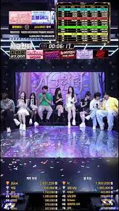

# FUNNATION — 홈 · 라이브 방송 (HTML/CSS)

Figma 시안을 순수 HTML + CSS로 옮긴 것입니다. 페이지는 세 개입니다.

| 페이지 | 파일 | 시안 (`펀네이션 v2.0` `7zkpaY37QfFiFvikeX9P6J`, 프레임 `64112:13122`) |
|---|---|---|
| 홈 | `index.html` | PC `64112:13123` / 모바일 `64112:15590` — 히어로 · 공지 배너 3장 · 띠 광고 배너 · 인기 라이브 · 라이브 탑 50 · 후원 컨텐츠 |
| 라이브 방송 | `live.html` | PC `64112:22620` / 모바일 `64112:23596` — 2depth(인기라이브·전체라이브) · 지금 라이브 중(20장) · 최신 영상 |
| 영상 상세 | `watch.html` | PC `64795:14999` (영상 상세 ver.3 — YouTube 플레이어 + 채팅/후원하기 탭) + 후원 패널 `64617:31228`(일반) · `64617:31309`(시그니처) · `64617:31423`(영상) · `64617:31523`(미션) — 홈·라이브 방송 썸네일을 누르면 열림 |

> 이전 기준 시안(`펀네이션 작업 원본` `63998:5230` 전체 방송, `63965:4070` 01.Dark 기획 보드)의 색·간격은 그대로 유지합니다.

```
index.html      홈 마크업 (Figma 노드 ID를 data-node-id 로 보존)
live.html       라이브 방송 마크업 — GNB·LNB·로그인·하단 내비는 index.html 과 같은 구조
app.js          두 페이지 공용 스크립트 (테마·LNB·로그인·히어로·광고 닫기)
styles.css      스타일 (디자인 토큰 → :root CSS 변수, [data-theme="light"] 오버라이드)
assets/         Figma 에서 내려받은 이미지·아이콘 (v2.0 신규는 assets/v2/)
assets/light/   라이트 테마용 단색 아이콘·로고 변형본
.design/        검수용 — target*.png(Figma 원본), render-*.png(현재 결과)
```

브라우저로 `index.html`을 열면 됩니다. 빌드 과정 없습니다.

**영상 상세 (`watch.html`)** — ver.3 (`64795:14999`)
- PC 시안만 있어 휴대폰에서도 1440px 화면을 축소해 보여줍니다(`<meta name="viewport" content="width=1440">`). 모바일 시안이 나오면 이 줄을 되돌리고 재배치합니다.
- 왼쪽은 YouTube 플레이어(`64795:15029`), 오른쪽은 채팅 398px(`64816:102304`). 둘 다 실제 YouTube 임베드이고, 영상 ID 는 `watch.html` 의 `.watch` 에 있는 `data-yt-id` 하나로 바꿉니다(`app.js` 가 플레이어 · 채팅 주소를 채움). 어떤 썸네일이든 같은 영상을 엽니다.
- GNB·LNB·로그인 마크업은 `index.html` 과 같고, LNB 는 숨겨 두었다가 GNB 햄버거로 영상 위에 겹쳐 엽니다. GNB 검색칸만 시안대로 300×36 네모 칸(`64822:102997`, 안내 글자 "크리에이터 검색"). 푸터는 없습니다.
- 채팅은 YouTube 라이브 채팅(`youtube.com/live_chat`)이라 **지금 라이브 중이거나 최초 공개인 영상**에서만 보이고, 다시보기·일반 영상은 비어 보입니다. 라이브가 끝나면 `data-yt-id` 를 새 라이브 ID 로 바꿔야 합니다. 채팅은 페이지 도메인(`embed_domain`)을 확인하므로 `file://` 로 열면 막혀 안내 문구만 보입니다 — `python3 -m http.server` 로 띄워 `http://localhost:8000/watch.html` 처럼 여세요. 테마를 바꾸면 채팅도 같은 테마로 다시 불러옵니다.
- 채팅 위 탭 **채팅 / 후원하기**. 후원하기를 누르면 후원 종류 탭(일반후원 · 시그니처 · 영상 · 미션, `64822:111705`)이 나오고, 그 바로 아래에서 해당 후원 시트(`64795:12825` 의 1·2번 화면 — #101010 · 아래 모서리 20px · 그림자)가 내려와 채팅 위에 겹칩니다. 채팅은 시트 아래로 계속 보이고, 마지막에 고른 종류를 기억합니다. 시안에는 보내기 버튼이 없지만 데모 후원을 위해 시트 맨 아래에 **후원하기** 버튼을 남겨 두었습니다. 금액 칩은 더하기, 전액은 내 펀캐시(100,000) 전부, 펀캐시보다 많으면 빨간 글씨, 시그니처를 고르면 그 금액, 익명을 켜면 닉네임이 "익명". 후원하기를 누르면 데모로 펀캐시만 줄이고 채팅 탭으로 돌아갑니다(YouTube 채팅에는 글을 남기지 않음).
GNB·LNB·푸터·로그인 마크업은 두 HTML 에 같이 들어 있으니, 공통 부분을 고칠 때는 두 파일을 함께 고쳐야 합니다.

**홈 / 라이브 방송 차이**
- 홈: 2depth 메뉴 없음. 공지 배너 3장 아래 본문 폭 전체에 띠 광고 배너(v2.0 `64112:13411`, `오늘 그만 보기` → 누르면 숨김, 저장하지 않아 새로고침하면 다시 표시). 모바일 앱바는 왼쪽 검색 아이콘(`64162:199925`, 누르면 검색 화면 · 로그인 화면에선 뒤로 가기로 바뀜) · 가운데 로고 · 언어 · 메뉴, 광고는 히어로 아래 프로모 배너로 바뀌고 공지 배너 3장은 숨김.
- 라이브 방송: 모바일 앱바는 뒤로(홈) · 제목 · 알림 · 언어 · 메뉴, 아래에 인기라이브/전체라이브 탭.
- 모바일 메뉴 버튼은 두 페이지 모두 앱바 오른쪽 → LNB 드로어도 오른쪽에서 열림.

## 상태 전환

| | 전환 방법 | 저장 |
|---|---|---|
| 다크 ↔ 라이트 | LNB 의 **밝은 테마** 토글 | `localStorage: funnation-theme` |
| 로그인 ↔ 로그아웃 | 우측 하단 **플로팅 버튼**(로그아웃 ↔ 로그인), 상단 **로그인** 버튼 | `localStorage: funnation-auth` |
| LNB 펼침 ↔ 접힘(70px 아이콘 레일, `64026:35837`) | GNB 좌측 **햄버거 버튼** | `localStorage: funnation-lnb` |
| 로그인 화면 (`64059:158794`, PC·모바일 같은 폼) | 로그아웃 상태에서 PC 상단 **로그인** 버튼 / 모바일 하단 내비 **로그인**(로그인 상태에서는 "내 정보"로 바뀌고 프로필·등급이 있는 메뉴 드로어를 엶). 주소가 `#login` 이 되며 브라우저 뒤로 가기·앱바 뒤로 버튼으로 닫힘. 데모: 아이디+비밀번호 입력 시 로그인, 비밀번호가 비면 오류 문구, SNS 버튼은 바로 로그인 | — |
| 회원가입 (`64454:202039`, PC·모바일 같은 폼) | 로그인 화면 아래 **회원가입** 링크. 주소 `#signup`, 브라우저 뒤로 가기로 로그인 화면 복귀. 약관동의(필수 4개 체크 시 다음) → 본인인증(휴대폰만, 데모라 고르면 바로 인증 완료) → 정보입력(아이디 중복확인·비밀번호 규칙·확인·닉네임·이메일 검사, 데모용 사용 중 아이디 `admin` `funnation` `test` `guest`) → 가입완료(입력 정보 요약, **펀네이션 시작하기** 누르면 로그인 상태). 앱바 뒤로: 2·3단계는 이전 단계, 1·4단계는 닫기. 입력값은 저장 안 함 | — |
| 검색 화면 (`64162:201098`, 모바일 전용) | 홈 앱바 왼쪽 **검색** 아이콘. 주소 `#search`, 앱바 뒤로 버튼·브라우저 뒤로 가기로 닫힘. 데모: 검색하면 최근 검색어 맨 위에 추가, X 로 하나씩·전체삭제로 모두 지움(저장 안 함) | — |
| 알림 화면 (`64162:200698`, 모바일 전용) | 앱바 **종** 아이콘(라이브 방송 앱바, 검색·알림 화면 앱바. 홈 앱바에는 시안대로 종 없음). 주소 `#notice`, 앱바 X 버튼으로 닫힘. 검색 → 알림으로 옮기면 기록을 쌓지 않아 X 한 번에 본문으로 돌아감 | — |
| 라이브 방송 인기라이브 ↔ 전체라이브 (`64586:116579`) | 서브탭(PC 2depth · 모바일 탭 공통) 클릭. 새로고침 없이 섹션만 바뀌고 주소에 `?tab=all` 이 남음. 전체라이브는 정렬 칩(시청자 높은/낮은 순·최근 방송 순, 선택만 바뀜) + VOD 5열 × 10줄 | — |
| 후원 컨텐츠 투표 카드 | 카드에 마우스를 올리거나 포커스(모바일은 탭). 영상(`assets/donation/poll.mp4`, 원본 `Box Card.mp4` 를 320px · 소리 없이 줄임)이 서서히 나타나 반복 재생되고, "투표" 제목이 위로 사라지며 "생방송에서 진행되는 투표에 후원으로 참여해 보세요"가 한 글자씩 떠오름. 벗어나면 되돌아가고 영상은 처음으로. 동작 줄이기 설정이면 영상 없이 문구만 바뀜 | — |
| 히어로 배너 | 5초 자동 순환 + 하단 점 클릭 + 좌우 화살표(PC 는 배너 hover 시 표시 + 글자·버튼·점이 36px 오른쪽으로 0.3초 이동, 모바일은 항상 표시, 끝에서 처음으로 순환) | — |

검수·공유용 URL 파라미터: `?theme=light|dark`, `?auth=in|out`, `?lnb=full|mini`, `?slide=0|1`, `?fx=on`(히어로 배경 효과 켜기 — 기본은 꺼짐), `#login`(로그인 화면, `?auth=out` 과 함께), `#search`·`#notice`(모바일 검색·알림 화면)

로그아웃 상태(`63998:4768`)에서 바뀌는 것 — 상단 우측(언어 pill + 로그인 버튼),
LNB 상단(프로필·등급 카드 → 방송 시작하기), LNB 하단(카카오 배너 → 추천 크리에이터 6명).
메뉴·카드 영역은 동일합니다.

**히어로 배너는 로그인 상태와 무관한 슬라이더**입니다. "펀네이션이 처음이세요?"(63998:5059) → "라이브를 더 재미있게!"(63998:5435) →
"방송을 더 쉽고 편하게!"(시안 없음) 순서로 순환하며, `prefers-reduced-motion` 에서는 자동 전환이 멈춥니다.

**슬라이더 이미지는 `assets/hero/` 에서만 관리합니다.** 슬라이드마다 이미지 한 장입니다.

| 파일 | 슬라이드 | 현재 크기 |
|---|---|---|
| `assets/hero/slide1.png` | 1번 — 펀네이션이 처음이세요? | 2172×724 |
| `assets/hero/slide2.png` | 2번 — 라이브를 더 재미있게! | 2172×724 |
| `assets/hero/slide3.png` | 3번 — 방송을 더 쉽고 편하게! (시안 없음, 2번 배치 재사용) | 2172×724 |

같은 이름으로 덮어쓰면 바로 반영됩니다. 비율(약 3:1)이 크게 다르면 위치를 다시 맞춰야 하며,
위치 스타일은 `styles.css` 의 `.hero__media-overlay`(2·3번)·`.hero__media-front`(1번)입니다.

## 모바일 (767px 이하)

시안에 모바일 화면이 없어 데스크톱 시안을 기준으로 재배치했습니다. 태블릿 레이아웃은 따로 두지 않아 768px 이상은 데스크톱(최소 1440px) 그대로입니다.
스타일은 `styles.css` 맨 끝 `@media (max-width: 767px)` 블록 하나에 모여 있습니다.

| 영역 | 모바일 동작 |
|---|---|
| 상태바 (`64026:37330`) | 시안 재현용 44px(9:41·다이내믹 아일랜드·신호·와이파이·배터리), 배경은 앱바와 같은 `#101010`. 앱바와 함께 상단 고정 |
| 앱바 (`64026:38039`) | 56px(패딩 4px) `#101010`. 좌: 메뉴·뒤로 / 가운데: 페이지 제목 / 우: 알림(배지)·언어. 데스크톱 GNB 는 숨김 |
| 2뎁스 탭 (`64026:38102`) | 앱바 바로 아래 48px, 탭 2개 균등. 선택 `#6ca6ff` + 2px 밑줄. **앱바와 함께 스크롤해도 상단 고정** |
| LNB | 앱바 좌측 **메뉴** 아이콘으로 여닫는 왼쪽 드로어(280px) + 어두운 배경. 배경 탭·ESC 로 닫힘. 데스크톱의 접기(mini) 설정과는 별개 |
| 하단 내비 (`64026:37346`, 항목은 `64059:158997`) | v2.0 `64112:15793` 기준 6개 — 홈·라이브·크리에이터·즐겨찾기·커뮤니티·**로그인**(로그인 상태에선 "내 정보"). 현재 페이지 항목이 파랗게 선택, 균등 분할, 좌우 4px. 아이콘 `assets/mo/nav-*.svg`, 선택 시 전체방송은 `nav-live-active.svg`·라벨 SemiBold + 홈 인디케이터, 전체 84px 고정 |
| 히어로 (`64026:38193`) | 좌우 꽉 차게(탭 바로 아래), 220px + 아래 10px, 모서리 없음(시안은 20px). 라벨 16px·제목 32px 2줄(줄 사이 16px, 물음표만 34px, `64059:159040`)·버튼 14px 등 시안 수치 그대로, 모두 가운데. 설명 문구 숨김 |
| 광고 배너 | 모바일에서는 숨김 |
| 칩·후원 카드 | 화면 끝까지 가로 스크롤 |
| 라이브·VOD 카드 | 한 줄 2장 |
| 푸터 | 강제 줄바꿈 해제, 구분선 대신 간격 |

### 복구 시점

모바일 작업 직전 상태가 `.backup/2026-10-06_before-mobile/` 에 있습니다 (`index.html`, `styles.css`, `README.md`).
되돌리려면 프로젝트 폴더에서:

```sh
cp .backup/2026-10-06_before-mobile/{index.html,styles.css,README.md} .
```

모바일 작업에서 새로 추가한 이미지는 없어 `assets/` 는 그대로 두면 됩니다.

## 테마

LNB 의 **밝은 테마** 토글로 다크 ↔ 라이트를 전환합니다. 선택은 `localStorage`
(`funnation-theme`)에 저장돼 다음 방문에도 유지됩니다. 기본값은 다크입니다.

검수·공유용으로 `index.html?theme=light` / `?theme=dark` 처럼 강제 지정할 수 있습니다.

색상은 전부 `:root` CSS 변수이고 `[data-theme="light"]` 블록이 값만 덮어씁니다.
히어로·광고 배너·더보기 버튼은 사진/컬러 위에 얹히므로 테마와 무관하게 밝은 글자를 고정했습니다.
단색 SVG 아이콘과 로고는 색이 파일에 박혀 있어 `assets/light/` 변형본으로 교체합니다.

## 구현 범위

| 영역 | Figma 노드 |
|---|---|
| 상단 GNB | `63998:5542` |
| LNB 사이드바 (프로필·등급·메뉴·카카오 배너) | `63998:5233` |
| LNB 멤버십 info 카드 (등급명·최근 30일·뱃지·진행 막대) | `64073:7513` — 뱃지 이미지 `assets/grade/vip.png` |
| 2depth 탭 | `63998:5408` |
| 히어로 캐러셀 | `63998:5435` |
| 조블페이 광고 바 | `63998:5421` |
| 인기 라이브 (카드 8장) | `63998:5471` |
| 라이브 탑 50 — VOD 카드 5열 × 2줄 | `64023:30519` |
| 다양한 후원 컨텐츠 (13장 가로 스크롤) | `64023:30539` |
| 홈 컨텐츠 카드 v2.0 (추천 토크 채널 · 라이브 탑 50 · 신입 스트리머 · 후원 컨텐츠) | `64112:13494` · `64112:13521` · `64371:9080` · `64112:13542` — 아바타 40 + 제목·채널(인증)·카테고리·날짜·태그. 라이브 탑 50 첫 칸은 AD 카드. 이미지 `assets/home/`, 후원 `assets/donation/v2-*`. 홈 전용 `.card--rich`·`.vod-card--rich` 라 live.html 카드는 그대로. 직전 상태 `.backup/2026-10-16_before-content-v2/` |
| 푸터 | `64023:30589` |
| 밝은 테마 | `64001:10152` |
| 로그아웃 상태 | `63998:4768` |

## 알려진 차이

- **폰트** — 디자인은 `Sandoll 네모니2`(섹션 제목·영상 상세 제목/탭), `Sandoll 맵씨`(히어로 h1), `Sandoll 격동굴림`(띠 광고 문구), `G마켓 산스 Bold`(퀵 카드 제목)를 씁니다. 산돌 서체는 설치돼 있을 때만 보이고 없으면 **Pretendard로 대체**합니다(`styles.css`의 `--font-nemony`·`--font-hero`·`--font-display`). G마켓 산스는 무료라 설치돼 있지 않으면 웹폰트(jsDelivr)로 불러옵니다(`--font-gmarket`). LNB 카카오 배너(`64073:7640`)는 배지 서체(`Sandoll 네모니2`)까지 시안 그대로 보이도록 **통짜 이미지** `assets/kakao-banner.jpg`(3x, 684×783)를 씁니다. 문구를 바꾸려면 Figma 에서 다시 내보내 같은 이름으로 덮어쓰세요. 본문 Pretendard는 CDN으로 로드합니다.
- 본문 좌우 여백이 시안의 30px → **32px**(1540/1476 규격)로 바뀌면서 카드가 2px 오른쪽으로 이동합니다.
  시안은 1행만 중앙 정렬(x=292), 2·3행은 좌측 정렬(x=290)로 **파일 자체가 2px 어긋나 있어** 세 행을 모두 맞췄습니다.

## 라이트 디자인과의 구조 차이 (미반영)

`64001:10152` 는 다크 화면의 테마 변형이 아니라 **다른 리비전**이라, 색 외에 아래가 다릅니다.
현재 구현은 **색상만** 라이트로 전환하고 구조는 다크 기준을 유지합니다.

1. ~~LNB 에 **펀캐시 블록**(999,999,000 캐시 + 충전 버튼)~~ → 반영됨 (`64021:3377`, 라이트·로그인 상태에서만 노출)
2. 상단 우측 순서가 다름 — 라이트: `스튜디오 → 계정 → 언어 → 지갑 → 알림 → 검색(228px, 우측)`,
   다크: `골드칩 → 계정 → 언어 → 알림 → 스튜디오 + 검색(396px pill, 중앙)` — v2.0 시안 64149:72817
3. 라이트에는 골드칩(1,250만원) 대신 **지갑 아이콘**이 있음
4. 광고 배너 소재가 다름 (조블페이 10% 할인 ↔ LoL 라운지)
5. 캔버스 높이 1520 ↔ 1400

## 구조 메모

- 레이아웃: **GNB 는 뷰포트 100% 폭**, **LNB(260px) 는 좌측 고정**, 본문은 남는 영역에서 **가운데 정렬**입니다.
- 본문 컨테이너(`.main__inner`)는 **최소 1184 / 최대 1540px**(좌우 32px 패딩 → **내부 1116 ~ 1476px**)입니다.
  히어로·광고 배너·라이브 섹션이 모두 이 폭을 따라 늘어납니다.
- 카드는 `grid-template-columns: repeat(4, 1fr)` 로 **한 줄 4장을 유지하며 늘어납니다.**
  내부 1116px 에서 정확히 267px(시안 치수), 내부 1476px 에서 357px 이 됩니다.

| 뷰포트 | 내부 폭 | 카드 폭 |
|---|---|---|
| 1440 (최소) | 1116 | 267 |
| 1540 | 1216 | 292 |
| 1700 | 1376 | 332 |
| 1800 이상 | 1476 (상한) | 357 |

- `.page` 에 `min-width: 1440px` 이 걸려 있어 그보다 좁아지면 가로 스크롤이 생깁니다.
- 검색창은 GNB 가 전체 폭이 되면서 **뷰포트 기준 중앙**에 놓입니다(본문 칼럼 기준 아님).
- 카드·칩·LNB 항목은 클래스 단위로 분리돼 있어 반복 생성(템플릿/컴포넌트)으로 바꾸기 쉽습니다.
- 로고는 새 시안(`64059:158309`, 187×30)의 SVG 조각 5개(`assets/logo/`)를 HTML/CSS 로 조립합니다 — 심볼·음영(심볼 모양 마스크)·F·픽셀 3개·워드마크. 라이트 테마는 워드마크만 검정 변형본(`assets/light/logo/wordmark.svg`)으로 교체합니다. 이전 PNG 로고(`assets/logo.png`, `assets/light/logo.png`)는 쓰지 않습니다.

## 파비콘

원본은 `assets/favicon/source.png`(512×417, 투명 배경 — 픽셀 장식 없는 F 심볼). 위아래 투명 여백을 넣어 정사각형으로 맞춘 뒤 만들었습니다.
`assets/favicon.ico`(16·32·48), `assets/favicon/favicon-32.png`·`favicon-192.png`·`favicon-512.png`(투명 배경),
`assets/favicon/apple-touch-icon.png`(180, 내비 배경색 `#0d0e1a` 위에 여백 20px). 원본을 바꾸면 이 파일들도 다시 만들어야 합니다.

## 세로 영상 썸네일 (64149:72779)

좌우가 검게 비워진 세로 영상은 검은 여백을 잘라낸 `*-v` 이미지(`assets/imgThumbnail3-v.png`, `assets/vod/thumb8-v.jpg`, 미사용 `assets/imgThumbnail11-v.png`)를 씁니다.
썸네일에 `thumb--vertical` 클래스를 붙이고 같은 이미지를 두 장 넣습니다 — `thumb__blur`(꽉 채움 · 블러 10px · 50% 어둡게) 위에 `thumb__main`(가운데, 높이 맞춤).

```html
<div class="card__thumb thumb--vertical">
  
  
  …
</div>
```

## 후원 컨텐츠 카드 자동 흐름

`app.js` 맨 아래. 카드가 본문 폭을 넘쳐 가려질 때만 카드를 한 벌 복제해 붙이고 왼쪽으로 30px/초씩 끊김 없이 흐릅니다(넘치는 동안 목록에 `is-marquee` 클래스).
폭이 넉넉해져 다 보이면 복제본을 지우고 멈춥니다. 마우스 올림·터치·포커스 중엔 멈추고(손으로 넘기기 가능, 터치는 뗀 뒤 1.5초 후 재개),
화면 밖·다른 탭·`prefers-reduced-motion` 에서는 움직이지 않습니다. 속도는 `SPEED` 값으로 조절합니다.
